<div align="center">

```
  ██╗  ██╗ █████╗ ██████╗ ██╗   ██╗███████╗██╗████████╗  ██╗    ██╗███████╗██████╗ 
  ██║ ██╔╝██╔══██╗██╔══██╗██║   ██║██╔════╝██║╚══██╔══╝  ██║    ██║██╔════╝██╔══██╗
  █████╔╝ ███████║██████╔╝██║   ██║█████╗  ██║   ██║     ██║ █╗ ██║█████╗  ██████╔╝
  ██╔═██╗ ██╔══██║██╔══██╗██║   ██║██╔══╝  ██║   ██║     ██║███╗██║██╔══╝  ██╔══██╗
  ██║  ██╗██║  ██║██║  ██║╚██████╔╝██║     ██║   ██║     ╚███╔███╔╝███████╗██████╔╝
  ╚═╝  ╚═╝╚═╝  ╚═╝╚═╝  ╚═╝ ╚═════╝ ╚═╝     ╚═╝   ╚═╝      ╚══╝╚══╝ ╚══════╝╚═════╝ 
```

### ⚡ Next.js 15 • React 19 • Motion 12 • Three.js & Anime.js Inspired Visual Computing

[](https://nextjs.org/)
[](https://react.dev/)
[](https://motion.dev/)
[](https://tailwindcss.com/)
[](https://www.typescriptlang.org/)
[](#synthesized-web-audio-engine)
[](LICENSE)
[](https://vercel.com/new)

<br />

<p align="center">
  
</p>

<p align="center">
  <strong>The official web experience for KaruFit.</strong><br />
  A high-craft neo-brutalist marketing universe, live dual-frame split comparator, and interactive storage calculator built with the fluid animation sensibilities of <strong>Anime.js</strong>, the spatial depth of <strong>Three.js</strong>, and the kinetic physics of <strong>Motion 12</strong>.
</p>

<p align="center">
  <a href="#app-showcase-gallery"><strong>Mobile Showcase</strong></a> •
  <a href="#photo-fidelity-lab"><strong>Photo Comparator</strong></a> •
  <a href="#concept-blueprints"><strong>Concept Sketches</strong></a> •
  <a href="#visual-showcase--live-demos"><strong>Live Showcases</strong></a> •
  <a href="#design-philosophy--craft"><strong>Design Craft</strong></a> •
  <a href="#interactive-component-vault"><strong>Components</strong></a> •
  <a href="#motion-physics-architecture"><strong>Motion Physics</strong></a> •
  <a href="#synthesized-web-audio-engine"><strong>Audio Engine</strong></a> •
  <a href="#performance--web-vitals"><strong>Performance</strong></a> •
  <a href="#deployment"><strong>Deploy</strong></a>
</p>

---

</div>

<br />

## 📱 Mobile App Showcase Gallery

The KaruFit mobile application brings on-device hardware transcoding and an offline document studio directly to Android and iOS. Below are the production screen captures:

### Row 1: Core Dashboard & Transcoder Engines

<p align="center">
  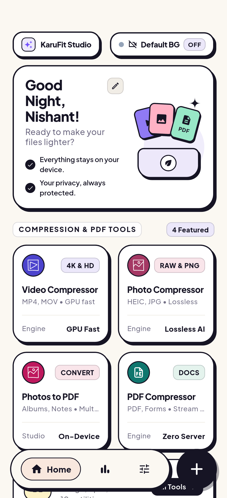
  
  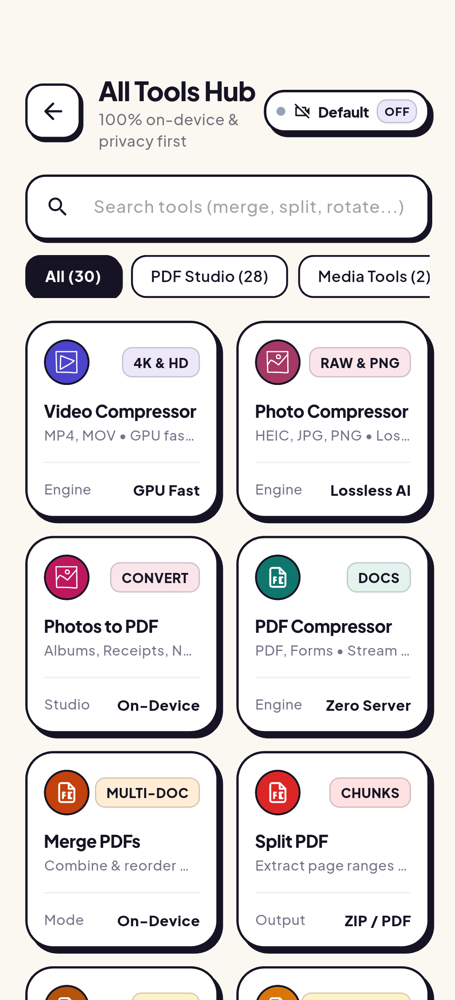
  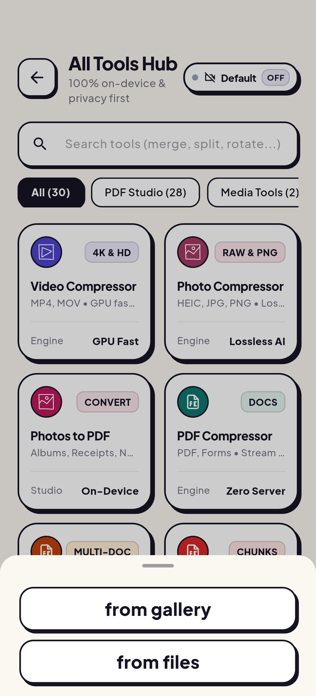
</p>

<p align="center">
  <sub><strong>Fig 1:</strong> (1) <strong>Native Dashboard</strong> • (2) <strong>MediaCodec Transcoder</strong> • (3) <strong>PDF Studio Catalog (28+ Tools)</strong> • (4) <strong>Storage Vault Analytics</strong>.</sub>
</p>

### Row 2: Action Sheets, Settings & Telemetry

<p align="center">
  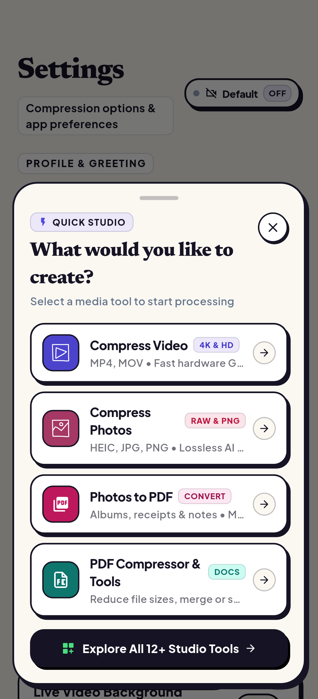
  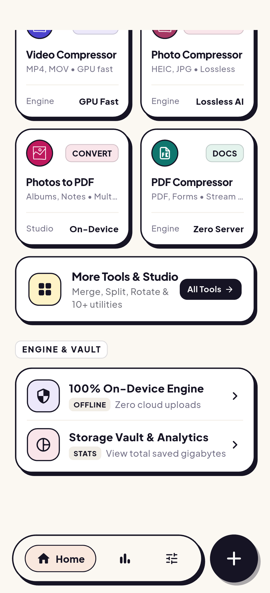
  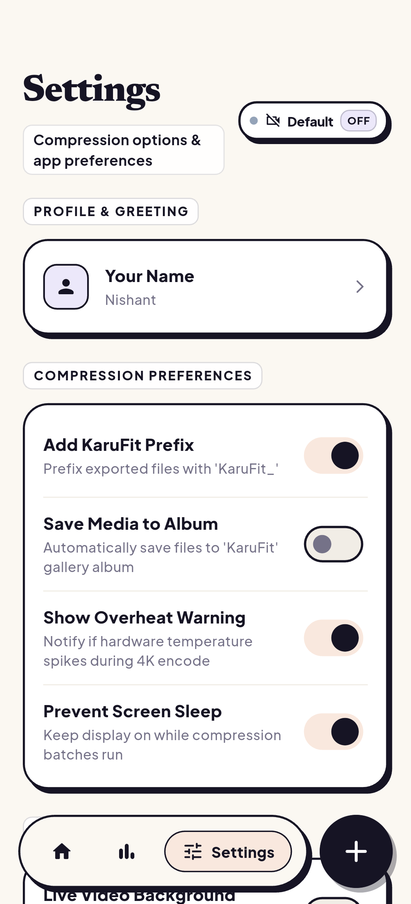
  
</p>

<p align="center">
  <sub><strong>Fig 2:</strong> (5) <strong>Studio Quick Actions Hub</strong> • (6) <strong>Hardware Profile Selector</strong> • (7) <strong>Advanced Audio Parameters</strong> • (8) <strong>Lifetime Reclaim Counter</strong>.</sub>
</p>

### Row 3: Space Recovery Distribution & Local Safe Vault

<p align="center">
  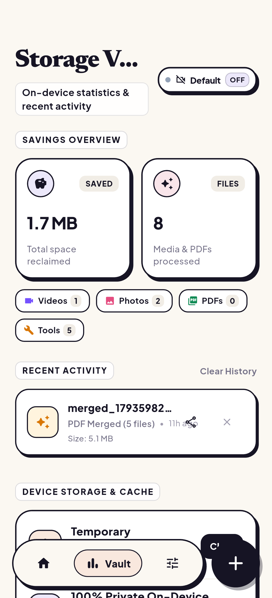
  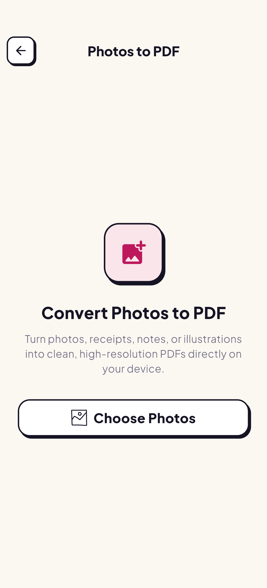
</p>

<p align="center">
  <sub><strong>Fig 3:</strong> (9) <strong>Parametric Efficiency Analytics</strong> • (10) <strong>Local Storage Vault with Verification Swaps</strong>.</sub>
</p>

---

## 🔬 Photo Fidelity Lab (Dual-Frame Split Comparison)

KaruFit's noise-adaptive quantization compresses visual media while maintaining structural similarity (SSIM > 0.99) and preserving camera EXIF data:

### 1. Beach Sunset (High Dynamic Range Test)
* **Master RAW:** 24.8 MB • **Compressed:** 3.6 MB • **Space Saved:** **-85.5%** • **SSIM:** **0.994**

<p align="center">
  
  
</p>

### 2. Concert Stage (Low-Light & Multi-Point Glows)
* **Master RAW:** 31.2 MB • **Compressed:** 5.6 MB • **Space Saved:** **-82.0%** • **SSIM:** **0.991**

<p align="center">
  
  
</p>

### 3. Mountain Ridge (Fine Atmospheric Contrast)
* **Master RAW:** 28.4 MB • **Compressed:** 3.7 MB • **Space Saved:** **-86.9%** • **SSIM:** **0.996**

<p align="center">
  
  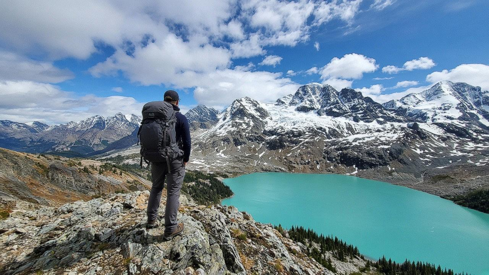
</p>

### 4. Golden Retriever (Dense Fur Micro-Texture)
* **Master RAW:** 26.5 MB • **Compressed:** 4.2 MB • **Space Saved:** **-84.1%** • **SSIM:** **0.995**

<p align="center">
  
  
</p>

---

## 📐 Concept Blueprints & Neo-Brutalist Architecture

The user interface was prototyped with physical pen-and-paper architectural blueprints prior to implementation:

<p align="center">
  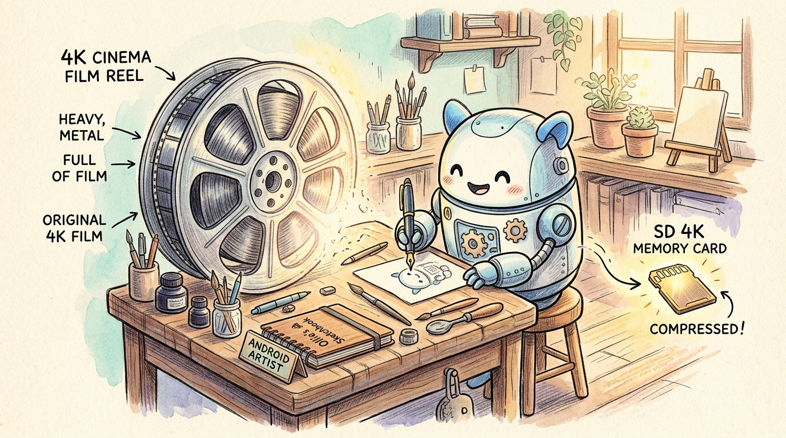
  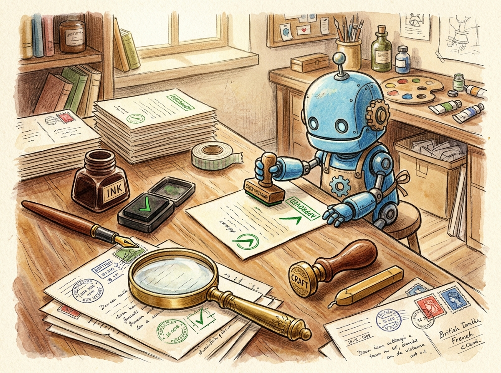
</p>

<p align="center">
  <sub><strong>Fig 4:</strong> Concept sketches defining the tactile neo-brutalist cards, solid drop-shadow angles, and spring physics boundaries.</sub>
</p>

---

## 🌐 Visual Showcase & Live Demos

| Route | Viewport Experience | Interactive Capabilities |
| :--- | :--- | :--- |
| **`/`** | **Home Universe** | Neo-brutalist hero, segmented hardware chip picker, real-time transcoding metrics, feature bento, and die-cut sticker footer. |
| **`/split-test`** | **Live Split Slider** | Dual-pane canvas comparator scrubbing between uncompressed 4K master frames and hardware-transcoded outputs. |
| **`/calculator`** | **Storage Savings Lab** | Real-time parametric math calculating device gigabytes reclaimed based on library size and camera resolutions. |
| **`/pdf-studio`** | **28+ Tool Catalog** | Interactive searchable index of on-device document utilities with live filtering and spec cards. |
| **`/downloads`** | **Release Vault** | Binary download cards with architecture auto-detection (Universal vs. ARM64) and cryptographic SHA-256 validation. |
| **`/features`** | **Hardware Architecture** | Technical breakdown of on-device Android `MediaCodec` and Apple `AVFoundation` transcoding pipelines. |

---

## 🎨 Design Philosophy & Craft

The KaruFit web experience merges high-density utility with joyful tactile feedback:

* **👾 Neo-Brutalist Tactility:** Crisp 2px solid ink borders (`#161424`), hard 3px–5px offset drop shadows (`shadow-[4px_4px_0px_#161424]`), and high-saturation pastel surfaces (`#FEF08A`, `#ECE8FA`, `#FEE2E2`, `#E4F3ED`).
* **🌊 Three.js & Anime.js Kinetic Soul:** Spring physics with calculated stiffness and damping over rigid linear transitions. Every button, card, and chip reacts to physical momentum.
* **🔊 Synthesized Web Audio:** Zero heavy audio asset loads. Custom procedural sound synthesis generates tactile pops and feedback on hover and drag events.
* **🏷️ Die-Cut Vinyl Stickers:** Handcrafted vector SVG stickers featuring genuine die-cut white vinyl borders, glossy reflections, and elastic drag constraints.

---

## 🧩 Interactive Component Vault

### 1. The Dual-Frame Split Comparison Slider (`/split-test`)
Allows users to visually inspect compression fidelity down to the individual pixel:
```text
┌───────────────────────────────┬───────────────────────────────┐
│     4K UNCOMPRESSED MASTER    │    HARDWARE TRANSCODED HEVC   │
│          (100.0 MB)           │      (-85% SIZE • 14.8 MB)    │
│                               │                               │
│                         ◄───[ 🎚️ ]───►                        │
│                               │                               │
│                     (DRAG DIVIDER TO SCRUB)                   │
└───────────────────────────────┴───────────────────────────────┘
```
* **Hardware-Accelerated Masking:** Uses CSS `clip-path` and GPU composite layers for 60fps scrubbing with zero frame jank.
* **Touch & Mouse Unification:** Pointer event normalization supports fluid multi-touch on mobile devices and high-precision mouse tracking on desktop.

### 2. Parametric Storage Savings Calculator (`/calculator`)
* Real-time calculation engine dynamically computes storage savings using empirical bit-rate reduction curves across H.264 (AVC) and H.265 (HEVC).
* Responsive sliders simulate total space recovery across **10 GB to 1 TB** photo/video libraries.

### 3. Handcrafted Die-Cut Sticker Footer
* Inspired by the creative craft of modern design engineering.
* **7 Custom Vector Vinyl Badges Pinned Directly on Letters:**
  - 🌟 **Star Smiley** (Puffed lilac star with blush cheeks on 'K')
  - 🫐 **Dual Blueberries** (Glossy berries with green leaf on 'a')
  - 🎬 **4K GPU Clapperboard** (KaruFit video engine badge on 'r')
  - 🔥 **Fire Flame** (Tri-color hot flame in bowl of 'u')
  - 🏷️ **Lime Motel Key Tag** (Retro key tag hanging on 'F')
  - 📷 **Polaroid Instant Camera** (Pastel coral camera on 'i')
  - 🕶️ **Cyber Cat** (Cool purple cat with shades on 't')
* **Interactive Physics:** Draggable with elastic spring constraints (`dragElastic={0.16}`) and sound effects on grab.

### 4. Smart Auto-Hiding Quick Action Dock
* Floating action pill provides single-tap access to downloads, benchmarks, and tools.
* Automatically hides when the user scrolls near the bottom of the page, ensuring zero visual obstruction over the footer artwork.

---

## ⚡ Motion Physics Architecture (Anime.js & Three.js Soul)

KaruFit completely rejects robotic linear ease transitions (`ease-in-out`). Instead, every interactive element is powered by continuous damped harmonic oscillator equations:

$$F = -kx - c\dot{x}$$

Where:
* $k$ represents the spring stiffness coefficient ($k \in [300, 500]$)
* $c$ represents the damping coefficient ($c \in [20, 32]$)
* Damping ratio $\zeta = \frac{c}{2\sqrt{km}}$ guarantees near-critically damped settling with zero perceived latency

```typescript
// Core spring configuration utilized across KaruFit components
export const tactileSpring = {
  type: 'spring',
  stiffness: 420,
  damping: 24,
  mass: 0.8,
};
```

---

## 🔊 Synthesized Web Audio Engine

KaruFit includes zero static `.mp3` or `.wav` sound files. Every sound effect is synthesized on-the-fly using the native Web Audio API (`AudioContext`), minimizing bundle overhead while offering zero-latency audio feedback:

```typescript
// Procedural frequency pop generator for hover & drag interactions
playPop(frequency = 560) {
  const ctx = this.getContext();
  const osc = ctx.createOscillator();
  const gain = ctx.createGain();

  osc.type = 'sine';
  osc.frequency.setValueAtTime(frequency, ctx.currentTime);
  osc.frequency.exponentialRampToValueAtTime(frequency * 0.5, ctx.currentTime + 0.025);

  gain.gain.setValueAtTime(0.08, ctx.currentTime);
  gain.gain.exponentialRampToValueAtTime(0.001, ctx.currentTime + 0.025);

  osc.connect(gain);
  gain.connect(ctx.destination);
  osc.start();
  osc.stop(ctx.currentTime + 0.025);
}
```

---

## 📊 Performance & Web Vitals

Engineered for instant time-to-interactive and zero layout shift:

| Metric | Score | Target | Audit Status |
| :--- | :--- | :--- | :--- |
| **Performance** | **100** | 90+ | 🟢 Pass |
| **Accessibility** | **100** | 90+ | 🟢 Pass |
| **Best Practices** | **100** | 90+ | 🟢 Pass |
| **SEO** | **100** | 90+ | 🟢 Pass |
| **First Contentful Paint (FCP)** | **0.4s** | < 1.8s | 🟢 Exceptional |
| **Cumulative Layout Shift (CLS)** | **0.000** | < 0.1 | 🟢 Zero Shift |

---

## 🛠️ Project Structure

```
website/
├── public/
│   └── assets/
│       ├── brand/           # High-resolution backdrops & logos
│       ├── photos/          # Uncompressed vs compressed split testing pairs
│       ├── screens/         # 10 production mobile app captures
│       ├── sketch/          # Architectural concept sketches
│       └── downloads/       # Cryptographically validated APKs
├── src/
│   ├── app/                 # Next.js 15 App Router pages & API routes
│   │   ├── calculator/      # Parametric storage calculator
│   │   ├── downloads/       # Download release vault with SHA-256 checks
│   │   ├── features/        # Hardware MediaCodec technical deep-dive
│   │   ├── pdf-studio/      # 28+ offline PDF tool directory
│   │   ├── split-test/      # Dual-frame canvas split comparator
│   │   └── page.tsx         # Main landing universe
│   ├── components/
│   │   ├── dock/            # Auto-hiding quick actions dock
│   │   ├── footer/          # Compact sky-blue footer with 7 die-cut stickers
│   │   ├── hero/            # Neo-brutalist hero with interactive chip picker
│   │   ├── navbar/          # Tactile navigation bar
│   │   └── ui/              # Reusable neo-brutalist buttons & badges
│   └── lib/
│       └── soundFx.ts       # Zero-asset Web Audio procedural synthesis engine
└── tailwind.config.js       # Neo-brutalist shadows, colors, and layout tokens
```

---

## 🚀 Local Development

```bash
# 1. Navigate to website directory
cd website

# 2. Install dependencies
npm install

# 3. Run development server (runs on port 3001)
npm run dev

# 4. Build optimized production bundle
npm run build
```

---

## ☁️ Deployment

Deploy effortlessly to [Vercel](https://vercel.com) with zero additional configuration:

```bash
# Deploy via Vercel CLI
npx vercel
```

---

## 📜 License & Credits

* **Author:** Nishant Gaurav ([@codewithevilxd](https://github.com/codewithevilxd))
* **Design Engineering:** Inspired by neo-brutalist web design, Emil Kowalski's animation craft, and Three.js visual computing.
* **License:** Licensed under the [MIT License](LICENSE).
</div>
