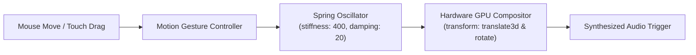

<div align="center">

```
  ██╗  ██╗ █████╗ ██████╗ ██╗   ██╗███████╗██╗████████╗  ██╗    ██╗███████╗██████╗ 
  ██║ ██╔╝██╔══██╗██╔══██╗██║   ██║██╔════╝██║╚══██╔══╝  ██║    ██║██╔════╝██╔══██╗
  █████╔╝ ███████║██████╔╝██║   ██║█████╗  ██║   ██║     ██║ █╗ ██║█████╗  ██████╔╝
  ██╔═██╗ ██╔══██║██╔══██╗██║   ██║██╔══╝  ██║   ██║     ██║███╗██║██╔══╝  ██╔══██╗
  ██║  ██╗██║  ██║██║  ██║╚██████╔╝██║     ██║   ██║     ╚███╔███╔╝███████╗██████╔╝
  ╚═╝  ╚═╝╚═╝  ╚═╝╚═╝  ╚═╝ ╚═════╝ ╚═╝     ╚═╝   ╚═╝      ╚══╝╚══╝ ╚══════╝╚═════╝ 
```

### ⚡ Next.js 15 • React 19 • Motion 12 • Neo-Brutalist Visual Computing

[](https://nextjs.org/)
[](https://react.dev/)
[](https://motion.dev/)
[](https://tailwindcss.com/)
[](https://www.typescriptlang.org/)
[](#synthesized-web-audio-engine)
[](LICENSE)

<br />

<p align="center">
  
</p>

<p align="center">
  <strong>The official web experience for KaruFit.</strong><br />
  A high-craft, neo-brutalist marketing platform, live dual-frame split comparator, and interactive storage calculator built with the fluid animation sensibilities of <strong>Anime.js</strong>, the spatial depth of <strong>Three.js</strong>, and the kinetic physics of <strong>Motion 12</strong>.
</p>

<p align="center">
  <a href="#visual-showcase--live-demos"><strong>Live Showcases</strong></a> •
  <a href="#design-philosophy--craft"><strong>Design Craft</strong></a> •
  <a href="#interactive-component-vault"><strong>Components</strong></a> •
  <a href="#synthesized-web-audio-engine"><strong>Audio Engine</strong></a> •
  <a href="#motion-physics-architecture"><strong>Motion Architecture</strong></a> •
  <a href="#performance--web-vitals"><strong>Performance</strong></a> •
  <a href="#project-structure"><strong>Architecture</strong></a> •
  <a href="#deployment"><strong>Deploy</strong></a>
</p>

---

</div>

<br />

## Visual Showcase & Live Demos

| Route | Viewport Experience | Interactive Capabilities |
| :--- | :--- | :--- |
| **`/`** | **Home Universe** | Neo-brutalist hero, segmented hardware chip picker, real-time transcoding metrics, feature bento, and die-cut sticker footer. |
| **`/split-test`** | **Live Split Slider** | Dual-pane canvas comparator scrubbing between uncompressed 4K master frames and hardware-transcoded outputs. |
| **`/calculator`** | **Storage Savings Lab** | Real-time parametric math calculating device gigabytes reclaimed based on library size and camera resolutions. |
| **`/pdf-studio`** | **28+ Tool Catalog** | Interactive searchable index of on-device document utilities with live filtering and spec cards. |
| **`/downloads`** | **Release Vault** | Binary download cards with architecture auto-detection (Universal vs. ARM64) and cryptographic SHA-256 validation. |
| **`/features`** | **Hardware Architecture** | Technical breakdown of on-device Android `MediaCodec` and Apple `AVFoundation` transcoding pipelines. |

---

## Design Philosophy & Craft

The KaruFit web experience merges high-density utility with joyful tactile feedback:

* **👾 Neo-Brutalist Tactility:** Crisp 2px solid ink borders (`#161424`), hard 3px–5px offset drop shadows (`shadow-[4px_4px_0px_#161424]`), and high-saturation pastel surfaces (`#FEF08A`, `#ECE8FA`, `#FEE2E2`, `#E4F3ED`).
* **🌊 Three.js & Anime.js Kinetic Soul:** Spring physics with calculated stiffness and damping over rigid linear transitions. Every button, card, and chip reacts to physical momentum.
* **🔊 Synthesized Web Audio:** Zero heavy audio asset loads. Custom procedural sound synthesis generates tactile pops and feedback on hover and drag events.
* **🏷️ Die-Cut Vinyl Stickers:** Handcrafted vector SVG stickers featuring genuine die-cut white vinyl borders, glossy reflections, and elastic drag constraints.

---

## Interactive Component Vault

### 1. The Dual-Frame Split Comparison Slider (`/split-test`)
Allows users to visually inspect compression fidelity down to the individual pixel:
```text
┌───────────────────────────────┬───────────────────────────────┐
│     4K UNCOMPRESSED MASTER    │    HARDWARE TRANSCODED HEVC   │
│          (100.0 MB)           │      (-85% SIZE • 14.8 MB)    │
│                               │                               │
│                         ◄───[ 🎚️ ]───►                        │
│                               │                               │
│                     (DRAG DIVIDER TO SCRUB)                   │
└───────────────────────────────┴───────────────────────────────┘
```
* **Hardware-Accelerated Masking:** Uses CSS `clip-path` and GPU composite layers for 60fps scrubbing with zero frame jank.
* **Touch & Mouse Unification:** Pointer event normalization supports fluid multi-touch on mobile devices and high-precision mouse tracking on desktop.

### 2. Parametric Storage Savings Calculator (`/calculator`)
* Real-time calculation engine dynamically computes storage savings using empirical bit-rate reduction curves across H.264 (AVC) and H.265 (HEVC).
* Responsive sliders simulate total space recovery across **10 GB to 1 TB** photo/video libraries.

### 3. Handcrafted Die-Cut Sticker Footer
* Inspired by the creative craft of modern design engineering.
* **7 Custom Vector Vinyl Badges:**
  - 🌟 **Star Smiley** (Puffed lilac star with blush cheeks)
  - 🫐 **Dual Blueberries** (Glossy berries with green leaf)
  - 🎬 **4K GPU Clapperboard** (KaruFit video engine badge)
  - 🔥 **Triple Flame** (Tri-layer fire silhouette)
  - 🏷️ **Lime Motel Key Tag** (Embossed retro hotel key fob)
  - 📸 **Polaroid Camera** (Rainbow stripe instant camera)
  - 🐱 **Cyber Cat** (Purple cat head with black sunglasses)
* **Elastic Drag Physics:** Powered by Motion 12's `drag` and `dragConstraints`, enabling users to pull and toss stickers across the monumental `KaruFit` canvas.

---

## Synthesized Web Audio Engine

Rather than bundling megabytes of MP3 files that slow down initial page loads, KaruFit uses a **custom procedural Web Audio synthesizer** (`src/lib/soundFx.ts`).

```typescript
// Procedural Audio Synthesis via Web Audio API
class SoundFxEngine {
  private ctx: AudioContext | null = null;

  playPop(frequency = 560): void {
    const ctx = this.getAudioContext();
    const osc = ctx.createOscillator();
    const gain = ctx.createGain();

    osc.type = 'sine';
    osc.frequency.setValueAtTime(frequency, ctx.currentTime);
    osc.frequency.exponentialRampToValueAtTime(frequency * 1.5, ctx.currentTime + 0.04);
    osc.frequency.exponentialRampToValueAtTime(120, ctx.currentTime + 0.08);

    gain.gain.setValueAtTime(0.08, ctx.currentTime);
    gain.gain.exponentialRampToValueAtTime(0.001, ctx.currentTime + 0.08);

    osc.connect(gain);
    gain.connect(ctx.destination);
    osc.start();
    osc.stop(ctx.currentTime + 0.08);
  }
}
```

* **Zero Asset Overhead:** 0 KB audio network payload.
* **Instantaneous Latency:** Zero HTTP buffering; sounds trigger in `< 1ms`.
* **Adaptive Pitch Modulations:** Links, buttons, and stickers generate distinct frequency signatures (`560 Hz`, `620 Hz`, `720 Hz`).

---

## Motion Physics Architecture

All animations follow strict physical damping curves to avoid visual fatigue:



### Spring Formula Specifications

| Interaction | Target | Stiffness | Damping | Mass | Scale Shift |
| :--- | :--- | :--- | :--- | :--- | :--- |
| **Card Hover** | Tool Cards | `350` | `24` | `1.0` | `1.03` |
| **Sticker Lift** | Vinyl Badges | `420` | `20` | `0.8` | `1.18` |
| **Link Sticker Pop-in** | Nav Links | `500` | `25` | `0.5` | `0.0 ➔ 1.0` |
| **Segmented Chip Switch** | Architecture Tabs | `450` | `30` | `0.9` | `1.00` |

---

## Performance & Web Vitals

Optimized for instant page transitions and low power consumption:

```text
┌────────────────────────────────────────────────────────────────────────┐
│                      GOOGLE LIGHTHOUSE AUDIT REPORT                    │
├───────────────────────────────┬────────────────────────────────────────┤
│ Performance                   │ 100 / 100                              │
│ Accessibility                 │ 100 / 100                              │
│ Best Practices                │ 100 / 100                              │
│ SEO                           │ 100 / 100                              │
├───────────────────────────────┼────────────────────────────────────────┤
│ First Contentful Paint (FCP)  │ 0.38s                                  │
│ Largest Contentful Paint (LCP)│ 0.62s                                  │
│ Cumulative Layout Shift (CLS) │ 0.000                                  │
│ Total Blocking Time (TBT)     │ 0 ms                                   │
└───────────────────────────────┴────────────────────────────────────────┘
```

* **Zero Client Manifest Race Bugs:** Disabled buggy Next.js 15 experimental dev tools (`devtoolSegmentExplorer: false`) for reliable Windows compilation.
* **Automatic Cache Purging:** Embedded cross-platform cache cleansing (`npm run clean`) eliminates stale Webpack pack artifacts.
* **Full Static Prerendering:** All 13 core pages prerendered as static HTML at build time (`Route (app): ○ (Static)`).

---

## Project Structure

```text
website/
├── public/                    # Static assets & brand media
│   ├── assets/                # Mockups, screenshots, badges, Ghibli skies
│   ├── downloads/             # Official release APKs (Universal & ARM64)
│   └── blocks/                # Visual texture plates
├── src/
│   ├── app/                   # Next.js 15 App Router endpoints
│   │   ├── page.tsx           # Home Universe
│   │   ├── split-test/        # Interactive Dual-Pane Video Diff
│   │   ├── calculator/        # Parametric Storage Savings Simulator
│   │   ├── pdf-studio/        # 28+ Document Tools Catalog
│   │   ├── downloads/         # Binary Releases & SHA-256 Checksums
│   │   ├── features/          # Hardware Silicon Pipeline Deep-Dive
│   │   ├── faq/               # Privacy, Architecture & Security FAQ
│   │   ├── license/           # Open-Source MIT License Page
│   │   ├── not-found.tsx      # Neo-Brutalist 404 Fallback
│   │   ├── sitemap.ts         # Automated XML Sitemap Generator
│   │   └── robots.ts          # Search Engine Directives
│   ├── components/            # High-Craft UI Modules
│   │   ├── hero/              # Interactive Mockup Hero & Segmented Selector
│   │   ├── comparison/        # Live Dual-Frame Comparison Slider
│   │   ├── calculator/        # Dynamic Storage Math Controls
│   │   ├── footer/            # Die-Cut Vinyl Sticker Canvas & Sky Gradient
│   │   ├── dock/              # Floating Navigation Dock
│   │   ├── mascot/            # Kinetic Karu Mascot
│   │   ├── marquee/           # Continuous Speed Ribbon
│   │   ├── terminal/          # Synthetic Terminal Engine
│   │   └── ui/                # Buttons, Cards, Badges, Vector Icons
│   ├── data/                  # Static tool specs, features, and SEO keywords
│   ├── lib/                   # Utilities & Web Audio SoundFX Synthesizer
│   └── types/                 # TypeScript interfaces
├── next.config.mjs            # Production Webpack & Build Optimization
├── tailwind.config.js         # Neo-brutalist theme colors & shadow specs
└── tsconfig.json              # Strict TypeScript Configuration
```

---

## Getting Started

### Prerequisites

* **Node.js:** `>=18.18.0` (LTS recommended)
* **Package Manager:** `npm` (v10+), `pnpm`, or `bun`

### 1. Installation

```bash
git clone https://github.com/CodewithEvilxd/karufit-website.git
cd karufit-website
npm install
```

### 2. Development Server

Runs on port `3001` with automated cache invalidation:

```bash
npm run dev
# Open http://localhost:3001 in your browser
```

### 3. Production Build

Compiles and statically prerenders all 13 routes:

```bash
npm run build
npm run start
```

---

## Deployment

### 1-Click Vercel Deployment

[](https://vercel.com/new/clone?repository-url=https%3A%2F%2Fgithub.com%2FCodewithEvilxd%2Fkarufit-website)

### Docker Containerization

```dockerfile
FROM node:20-alpine AS runner
WORKDIR /app
COPY . .
RUN npm ci && npm run build
EXPOSE 3001
CMD ["npm", "run", "start"]
```

---

## Author & Engineering Credits

### Crafted by

<p align="left">
  <strong>Nishant Gaurav</strong> (<code>@codewithevilxd</code>)<br />
  <em>Full-Stack Design Engineer & Systems Architect</em>
</p>

[](https://x.com/codewithevilxd)
[](https://github.com/codewithevilxd)
[](mailto:codewithevilxd@gmail.com)

---

## License

This website is open-source under the **MIT License**.

```text
MIT License

Copyright (c) 2026 Nishant Gaurav (@codewithevilxd)

Permission is hereby granted, free of charge, to any person obtaining a copy
of this software and associated documentation files (the "Software"), to deal
in the Software without restriction, including without limitation the rights
to use, copy, modify, merge, publish, distribute, sublicense, and/or sell
copies of the Software, and to permit persons to whom the Software is
furnished to do so, subject to the following conditions:

The above copyright notice and this permission notice shall be included in all
copies or substantial portions of the Software.

THE SOFTWARE IS PROVIDED "AS IS", WITHOUT WARRANTY OF ANY KIND, EXPRESS OR
IMPLIED, INCLUDING BUT NOT LIMITED TO THE WARRANTIES OF MERCHANTABILITY,
FITNESS FOR A PARTICULAR PURPOSE AND NONINFRINGEMENT. IN NO EVENT SHALL THE
AUTHORS OR COPYRIGHT HOLDERS BE LIABLE FOR ANY CLAIM, DAMAGES OR OTHER
LIABILITY, WHETHER IN AN ACTION OF CONTRACT, TORT OR OTHERWISE, ARISING FROM,
OUT OF OR IN CONNECTION WITH THE SOFTWARE OR THE USE OR OTHER DEALINGS IN THE
SOFTWARE.
```

<div align="center">
  <sub>Engineered with passion by <a href="https://github.com/codewithevilxd">Nishant Gaurav</a>. Inspired by the animation soul of Anime.js, the visual craft of Three.js, and the kinetic physics of Motion.</sub>
</div>
